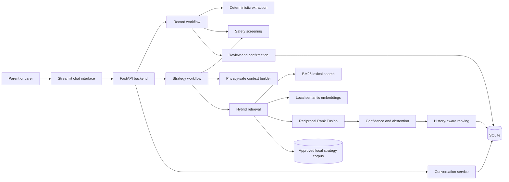

# Hey Joey: Privacy-Aware Hybrid RAG Assistant

Hey Joey is a local-first, safety-aware support system that turns parent or carer observations into structured journal records and retrieves source-backed support strategies from an approved local document library.

The project is designed as an **AI-assisted system rather than a generic chatbot**. Deterministic extraction, safety screening, confirmation, persistence and operational controls remain explicit and testable; local semantic retrieval is used as one component inside that wider workflow.

- **Current release:** `v0.1.0`
- **Runtime:** Python 3.12, FastAPI, Streamlit, SQLite and Docker
- **External model API required:** No

> Hey Joey is an MSc/portfolio prototype. It is not a clinical, diagnostic, emergency or safeguarding service.

---

## Why This Project Exists

Parents and carers often record important observations in natural language, but unstructured notes are difficult to reuse for later reflection or support planning. Hey Joey demonstrates a system that can:

- capture a free-text observation;
- build and refine a structured record across several turns;
- require explicit confirmation before saving;
- retrieve relevant strategies from approved local documents;
- show the supporting evidence behind each suggestion;
- remember conversation and strategy-feedback history;
- abstain when the available evidence is too weak;
- run without a paid language-model API.

The result is a verifiable support-management workflow, not a free-form answer generator.

---

## System Overview



### Core design principle

```text
natural-language input
→ deterministic workflow logic
→ safety screening
→ local retrieval where relevant
→ explicit evidence and confidence
→ user confirmation
→ local persistence
```

The application can still perform its main record-management workflow without a generative model. Local embeddings improve retrieval, but they do not control safety, confirmation or database writes.

---

## Main Workflows

### 1. Record what happened

A parent or carer enters a natural-language observation. Joey then:

1. creates a structured draft;
2. identifies missing information;
3. asks a targeted follow-up question;
4. updates the same draft over multiple turns;
5. presents a final review;
6. saves only after explicit confirmation.

A structured record can include:

- entry type and summary;
- date and time of day;
- anxiety level;
- mood zone and mood labels;
- behaviours and activity;
- environment and possible triggers;
- Quick Track suggestions;
- relevant strategy categories;
- risk flags;
- missing information;
- confidence and confirmation state.

### 2. Ask for a strategy

A parent or carer asks for support relevant to a situation. Joey then:

1. screens the question for safety concerns;
2. builds a privacy-reduced contextual query;
3. searches the approved local strategy library;
4. combines BM25 and semantic rankings;
5. evaluates retrieval confidence;
6. abstains when the evidence is insufficient;
7. applies modest history-aware adjustments;
8. returns source-backed options with cautious wording;
9. stores optional feedback for later ranking decisions.

---

## Key Engineering Capabilities

| Capability | Implementation |
|---|---|
| Structured data capture | Deterministic extraction and multi-turn draft refinement |
| Safety | Rule-based screening takes priority over ordinary retrieval |
| Retrieval | Local BM25 plus local semantic embeddings |
| Fusion | Reciprocal Rank Fusion rather than raw-score mixing |
| Confidence | Evidence thresholds and explicit abstention behaviour |
| Personalisation | Stored strategy usage and feedback make limited ranking adjustments |
| Persistence | SQLite records, conversations, searches and feedback |
| Backend | Versioned FastAPI routes with OpenAPI documentation in local mode |
| Frontend | Streamlit chat client communicating through HTTP only |
| Containerisation | Separate API and frontend services using one production image |
| Configuration | Validated environment-based local and production settings |
| Observability | Text logs locally and redacted JSON logs in production mode |
| CI/CD | Python regression CI, Docker build CI and versioned GHCR releases |
| Privacy | Synthetic-only production-demo defaults and repository safety checks |

---

## Safety and Privacy Boundary

Hey Joey is designed to:

- avoid diagnosis and treatment claims;
- avoid medication or dosage recommendations;
- avoid advising medication changes;
- avoid claiming a certain cause;
- detect medication mentions without turning them into advice;
- detect direct safety or self-injury concerns;
- stop ordinary strategy retrieval when a safety concern takes priority;
- require confirmation before storing a structured record;
- avoid intentionally logging parent notes, answers or retrieved passages.

Safety screening is deterministic, but it cannot guarantee recognition of every indirect, ambiguous or unusual expression of risk.

### Data policies

The runtime supports two explicit policies:

| Policy | Intended use |
|---|---|
| `local_private` | Private local development on the user’s own machine |
| `synthetic_only` | Portfolio, production-style and recruiter-facing demonstrations |

Production defaults to:

```text
HEY_JOEY_DEMO_MODE=true
HEY_JOEY_DATA_POLICY=synthetic_only
HEY_JOEY_ALLOW_PRIVATE_DATA=false
```

Never place real child or family information, private SQLite databases, credentials or private documents in a public repository, screenshot, container image or hosted demo.

---

## Hybrid Retrieval Pipeline

The strategy pipeline combines:

- BM25 lexical retrieval;
- semantic embedding retrieval;
- Reciprocal Rank Fusion;
- strategy-level deduplication;
- privacy-safe contextual query construction;
- retrieval-confidence assessment;
- history-aware ranking adjustments.

### Semantic model

```text
sentence-transformers/all-MiniLM-L6-v2
```

The model runs locally and produces normalised 384-dimensional `float32` embeddings. No paid API key is required.

### Why keep hybrid retrieval?

A semantic retriever can recognise conceptually similar wording, while BM25 preserves direct lexical evidence. Reciprocal Rank Fusion combines their rankings without pretending that cosine-similarity and BM25 scores share the same numerical scale.

### History-aware ranking

Stored feedback can make small, auditable adjustments when base retrieval results are close. For example:

- an active strategy can receive a modest positive adjustment;
- positive feedback can break a close tie;
- negative feedback can reduce a strategy’s score;
- an unseen strategy can be labelled as new.

Feedback never replaces the source-relevance score and is deliberately prevented from overwhelming retrieval evidence.

---

## Local Strategy Corpus

The prototype corpus snapshot contains:

- 10 Hey Joey source documents containing 217 individual support strategies;
- 359 processed chunks;
- 257 strategy chunks;
- 102 context chunks.

Raw documents, processed text, generated chunks and embedding indexes are intentionally excluded from Git and from the container image. They are mounted or generated locally.

Place approved documents in:

```text
data/raw/strategies/
```

Then build the local embedding index:

```powershell
python -m rag.build_embedding_index
```

The record workflow does not depend on this corpus. Strategy search requires the approved corpus and generated local indexes.

---

## Persistence

SQLite is the project’s storage boundary. It persists:

- confirmed structured records;
- conversation sessions and messages;
- resumable workflow drafts;
- strategy searches and ranked results;
- strategy feedback and usage history.

Default local database path:

```text
data/local/joey.db
```

The database and private runtime folders are excluded from version control.

---

## API

The FastAPI backend exposes versioned workflow routes.

### System routes

```text
GET /health
GET /ready
GET /version
```

### Conversation routes

```text
POST /api/v1/conversations/sessions
GET  /api/v1/conversations/sessions/latest
GET  /api/v1/conversations/sessions/{session_id}
POST /api/v1/conversations/sessions/{session_id}/exchanges
```

### Record routes

```text
POST /api/v1/record/sessions
GET  /api/v1/record/sessions/{session_id}
POST /api/v1/record/sessions/{session_id}/messages
POST /api/v1/record/sessions/{session_id}/confirm
POST /api/v1/record/sessions/{session_id}/reject
```

### Strategy routes

```text
POST /api/v1/strategies/search
GET  /api/v1/strategies/searches/{search_id}
POST /api/v1/strategies/feedback
```

Interactive API documentation is available locally at:

```text
http://127.0.0.1:8000/docs
```

API documentation is disabled by default in production mode.

---

## Repository Structure

```text
Chatbot_Joey/
├── .github/workflows/
│   ├── ci.yml
│   ├── docker-ci.yml
│   └── release.yml
├── api/
│   ├── main.py
│   ├── models.py
│   └── routers/
├── app/
│   ├── settings.py
│   ├── logging_config.py
│   ├── api_client.py
│   ├── extractor.py
│   ├── conversation_manager.py
│   ├── conversation_persistence.py
│   ├── record_workflow_service.py
│   ├── strategy_workflow_service.py
│   ├── context_builder.py
│   └── streamlit_app.py
├── rag/
│   ├── bm25_retriever.py
│   ├── semantic_retriever.py
│   ├── hybrid_retriever.py
│   ├── retrieval_confidence.py
│   ├── strategy_history_ranker.py
│   └── history_aware_strategy_service.py
├── safety/
│   └── safety_guard.py
├── storage/
│   ├── database.py
│   ├── conversation_storage.py
│   ├── strategy_feedback.py
│   └── feedback_history_provider.py
evaluation/
├── final_thesis/
│   ├── data/
│   └── results/
├── run_ci_suite.py
├── run_extractor_on_dataset.py
├── run_retrieval_comparison.py
└── test_*.py
├── scripts/
│   └── apply_repository_safety.py
├── docs/
│   ├── production_configuration.md
│   └── container_release.md
├── assets/
├── data/
├── Dockerfile
├── compose.yaml
├── compose.production.yaml
├── requirements.txt
└── README.md
```

---


## Code Supporting the MSc Thesis

This repository contains the wider Hey Joey engineering prototype as well as the code used for the MSc Data Science thesis:

**Machine Learning Analysis of Well-Being and Behaviour Data for Hey Joey App**

The dissertation evaluates a specific subset of the repository. Its three research areas are:

1. deterministic extraction of structured information from synthetic parent or carer observations;
2. comparison of Rule-based, BM25-only, Semantic-only and Hybrid Reciprocal Rank Fusion retrieval;
3. confidence-based abstention when retrieved evidence is insufficient.

The FastAPI, Streamlit, SQLite, Docker, CI/CD and production-configuration components support the wider prototype and reproducibility of the system, but they are not the primary experimental components evaluated in the dissertation.

### Main thesis code

| Thesis component | Main code | Purpose |
|---|---|---|
| Structured extraction | `app/extractor.py` | Converts free-text observations into project-defined structured fields using deterministic rules and patterns. |
| Strategy-document loading | `rag/document_loader.py` | Loads and normalises the approved local strategy documents used by the retrieval pipeline. |
| Corpus chunking | `rag/strategy_chunker.py` | Splits strategy documents into retrievable strategy and contextual chunks while retaining source metadata. |
| Semantic index construction | `rag/build_embedding_index.py` | Generates the local sentence-embedding index used for semantic retrieval. |
| Rule-based retrieval baseline | `rag/strategy_retriever.py` | Provides the deterministic retrieval baseline used for comparison. |
| BM25 retrieval | `rag/bm25_retriever.py` | Implements the lexical BM25 retrieval method evaluated in the thesis. |
| Semantic retrieval | `rag/semantic_retriever.py` | Retrieves strategy chunks using local `all-MiniLM-L6-v2` sentence embeddings. |
| Hybrid RRF retrieval | `rag/hybrid_retriever.py` | Combines BM25 and semantic ranked lists using Reciprocal Rank Fusion. |
| Confidence and abstention | `rag/retrieval_confidence.py` | Assesses retrieval evidence and allows the system to abstain when support is insufficient. |
| Final thesis experiment runner | `evaluation/final_thesis/run_final_ml_experiments.py` | Runs the final 30-case extraction, four-method retrieval and confidence/abstention experiments reported in the dissertation. |
| Final thesis datasets | `evaluation/final_thesis/data/` | Contains the fixed synthetic extraction, retrieval and confidence datasets used for the final dissertation experiments. |
| Final thesis results | `evaluation/final_thesis/results/` | Contains the case-level outputs, summary metrics and experiment manifest produced by the final dissertation experiments. |
| Development extraction evaluation | `evaluation/run_extractor_on_dataset.py` | Earlier development evaluation using the broader synthetic journal dataset rather than the final 30-case hold-out set. |
| Development retrieval evaluation | `evaluation/run_retrieval_comparison.py` | Earlier development comparison using the smaller retrieval dataset rather than the final 30-query thesis dataset. |
| Confidence regression checks | `evaluation/test_retrieval_confidence.py` | Tests strong, moderate and weak evidence behaviour as a regression check rather than running the final dissertation confidence experiment. |

### Final thesis evaluation artefacts

The fixed datasets and result artefacts used for the final dissertation
experiments are preserved separately under:

```text
evaluation/final_thesis/
├── data/
│   ├── confidence_cases.json
│   ├── holdout_extraction_cases.csv
│   ├── holdout_extraction_dataset.xlsx
│   └── retrieval_final_cases.json
├── results/
│   ├── extraction_case_results.csv
│   ├── extraction_summary.csv
│   ├── retrieval_final_case_results.csv
│   ├── retrieval_final_results.json
│   ├── retrieval_final_summary.csv
│   ├── confidence_case_features.csv
│   ├── confidence_threshold_summary.csv
│   ├── confidence_pareto_frontier.csv
│   └── final_experiment_manifest.json
└── run_final_ml_experiments.py
```

---


### Relationship to the dissertation

The thesis reports three experiments using fixed synthetic evaluation datasets. The extraction experiment evaluates anxiety level, mood zone and safety status. The retrieval experiment compares the four retrieval methods using Hit@1, Hit@3, Mean Reciprocal Rank and latency. The confidence experiment evaluates the trade-off between answer coverage and reliability using coverage, selective accuracy and overall decision accuracy.

The wider application code in `api/`, `storage/`, and the remaining `app/` modules demonstrates how these research components can operate inside a complete local prototype. Those components provide workflow management, persistence, API access and the Streamlit interface, but the dissertation's quantitative results are based primarily on the extraction, retrieval and confidence components listed above.

All thesis evaluation data are synthetic. No genuine child or family information was used for the reported experiments, and the project-defined labels should not be interpreted as clinical diagnoses.

---

## Quick Start with Docker

Docker is the simplest way to run both services with the same environment used by the automated Docker build.

### 1. Start the application

From the project root:

```powershell
docker compose up --wait
```

The first build can take time because it installs the local embedding stack and preloads the sentence-transformer model.

### 2. Open the interfaces

```text
Streamlit: http://127.0.0.1:8501
FastAPI:   http://127.0.0.1:8000
API docs:  http://127.0.0.1:8000/docs
```

### 3. Stop the application

```powershell
docker compose down
```

Local Compose ports bind to `127.0.0.1` by default, so they are not exposed to other devices on the network.

---

## Local Python Setup

### 1. Create a virtual environment

```powershell
python -m venv .venv
.venv\Scripts\Activate.ps1
```

### 2. Install dependencies

```powershell
python -m pip install --upgrade pip
python -m pip install -r requirements.txt
```

### 3. Start the API

```powershell
python -m uvicorn api.main:app --host 127.0.0.1 --port 8000
```

### 4. Start Streamlit in a second PowerShell window

```powershell
$env:HEY_JOEY_API_URL="http://127.0.0.1:8000"
python -m streamlit run app\streamlit_app.py
```

The Streamlit frontend uses the FastAPI HTTP boundary rather than importing backend workflow services directly.

---

## Production-Style Synthetic Demo

Create an untracked production environment file:

```powershell
Copy-Item .env.production.example .env.production
```

Validate the merged configuration:

```powershell
docker compose --env-file .env.production `
  -f compose.yaml `
  -f compose.production.yaml `
  config
```

Start the production-style configuration:

```powershell
docker compose --env-file .env.production `
  -f compose.yaml `
  -f compose.production.yaml `
  up --wait
```

The production override adds:

- CPU, memory and process limits;
- restart policies;
- JSON log rotation;
- Linux capability removal;
- `no-new-privileges`;
- a named persistent data volume;
- synthetic-only demonstration defaults;
- disabled API documentation by default.

See [`docs/production_configuration.md`](docs/production_configuration.md) for the complete configuration model.

---

## Evaluation

The dissertation reports three final experiments using fixed synthetic evaluation datasets: structured extraction, retrieval comparison and confidence-based abstention.

### Structured extraction

The final extraction evaluation used 30 synthetic hold-out parent or carer observations.

| Field | Accuracy | Macro F1 / F1 |
|---|---:|---:|
| Anxiety level | 53.3% | 0.5352 Macro F1 |
| Mood zone | 63.3% | 0.6041 Macro F1 |
| Safety status | 90.0% | 0.6667 F1 |

Safety classification achieved 75.0% precision and 60.0% recall. Exact three-field accuracy was 46.7%, meaning anxiety, mood zone and safety were all predicted correctly for 14 of the 30 observations.

These results show that the deterministic extractor remained transparent and reproducible but was sensitive to linguistic variation, especially negation, historical context, indirect descriptions and positive or resolved wording.

### Retrieval comparison

The final thesis retrieval evaluation used the same 30 synthetic queries across the ten strategy collections to compare Rule-based, BM25-only, Semantic-only and Hybrid Reciprocal Rank Fusion retrieval with `top_k = 3`.

| Retriever | Hit@1 | Hit@3 | MRR | Mean warm-run latency |
|---|---:|---:|---:|---:|
| Rule-based baseline | 40.0% | 50.0% | 0.4500 | 0.615 ms |
| BM25-only | 66.7% | 86.7% | 0.7611 | 4.316 ms |
| Semantic-only | 86.7% | 90.0% | 0.8833 | 28.765 ms |
| Hybrid RRF | 86.7% | 90.0% | 0.8833 | 30.142 ms |

Semantic-only and Hybrid RRF achieved the same ranking metrics on this dataset. Hybrid RRF therefore matched, rather than exceeded, Semantic-only retrieval. BM25 remained competitive at Hit@3 and provided useful lexical evidence, while Rule-based retrieval was the fastest but produced the weakest ranking performance.

These results apply only to the designed 30-case synthetic retrieval evaluation. They do not establish universal retrieval quality or clinical effectiveness.

### Confidence and abstention

The confidence evaluation used 30 synthetic queries to test whether the system should answer or abstain when retrieval evidence was weak.

| Minimum overlap requirement | Coverage | Selective accuracy | Overall decision accuracy |
|---|---:|---:|---:|
| Current configuration / overlap ≥ 1 | 66.7% | 65.0% | 76.7% |
| Overlap ≥ 2 | 46.7% | 78.6% | 83.3% |
| Overlap ≥ 3 | 23.3% | 100.0% | 73.3% |

Among the tested settings, an overlap requirement of at least two produced the highest overall decision accuracy at 83.3%, while reducing coverage to 46.7%. A stricter threshold of at least three increased selective accuracy to 100% but abstained too often, reducing overall decision accuracy.

### Current regression suite

Release `v0.1.0` completed the local continuous-integration suite with:

```text
Discovered test modules: 21
Modules passed: 21/21
Status: PASS
```

The suite covers:

- FastAPI health, readiness and OpenAPI behaviour;
- record-session creation, follow-ups, confirmation and rejection;
- strategy search, safety priority, abstention and feedback;
- API-client failures and timeout handling;
- SQLite record, conversation and feedback persistence;
- context construction and multi-turn state;
- history-aware ranking;
- Streamlit-to-API integration;
- Docker and Compose configuration;
- production settings and repository safety;
- CI, Docker CI and release-pipeline configuration.

Run the complete suite with:

```powershell
python -m evaluation.run_ci_suite
```

Run repository privacy checks independently with:

```powershell
python -m evaluation.test_repository_safety
```

---

## Continuous Integration and Releases

The repository contains three GitHub Actions workflows.

### Joey CI

Runs the Python 3.12 compilation and regression suite on pushes and pull requests.

### Joey Docker CI

Validates the Compose configuration and builds the production Docker image for `linux/amd64` without publishing it. BuildKit layers are cached between runs.

### Joey Container Release

A semantic-version tag such as `v0.1.0` publishes a versioned image to GitHub Container Registry with:

```text
0.1.0
v0.1.0
sha-<commit>
latest
```

The release includes OCI source, revision and version labels, BuildKit provenance and an SBOM.

Create a release only from a clean, tested commit:

```powershell
git tag -a v0.1.0 -m "Hey Joey v0.1.0"
git push origin v0.1.0
```

See [`docs/container_release.md`](docs/container_release.md) for the release and package-visibility process.

---

## Production Safeguards Included

The current project includes production-style controls, but these controls do not make it suitable for processing real family data on a public server.

Implemented safeguards include:

- central validated runtime settings;
- safe production-demo defaults;
- explicit private-data decisions;
- loopback-only local port binding;
- non-root Docker execution;
- container CPU, memory and process limits;
- dropped Linux capabilities;
- `no-new-privileges`;
- health-aware service startup;
- bounded and rotated container logs;
- redacted application-owned JSON logs;
- disabled production API documentation;
- secret and private-file repository checks;
- versioned immutable container releases.

A real deployment involving identifiable family or child data would still require authentication, authorisation, transport encryption, encryption at rest, secrets management, backups, retention and deletion controls, audit trails, security testing, monitoring, incident response and formal privacy approval.

---

## Limitations

- Evaluation datasets are small and synthetic.
- Retrieval judgements are not yet based on an independent domain-expert study.
- Deterministic extraction may miss unusual phrasing, negation or indirect context.
- Follow-up questions may not always target the most important missing detail.
- Safety rules cannot recognise every possible risk expression.
- Strategy retrieval depends on a locally supplied approved corpus and generated indexes.
- Source-backed retrieval does not demonstrate clinical effectiveness.
- History-aware ranking has not been validated with real longitudinal users.
- SQLite is appropriate for the prototype but not a multi-user production database.
- The released container currently targets `linux/amd64`.
- No approved usability study with parents, carers or professionals has been completed.
- No live Hey Joey mobile application or production database integration was available.
- The public-demo configuration must remain synthetic-only.

---

## Remaining Work Before Real-World Deployment

The core engineering prototype is complete. Remaining work is primarily validation, governance and product integration:

1. conduct domain-expert retrieval review;
2. expand and independently label the evaluation set;
3. run an approved usability study;
4. add user authentication and role-based access control;
5. add encryption, managed secrets and audited backups;
6. define retention, deletion and data-subject processes;
7. complete privacy-impact and security assessments;
8. integrate with the real Hey Joey profile, journal and insights data contracts;
9. add production monitoring and incident-response procedures;
10. assess a controlled local generative rewriting component without weakening deterministic safety or evidence checks.

---

## Project Status

| Area | Status |
|---|---|
| Structured journal workflow | Complete |
| Multi-turn follow-up and confirmation | Complete |
| Deterministic safety layer | Complete |
| Local semantic and BM25 retrieval | Complete |
| Retrieval confidence and abstention | Complete |
| History-aware strategy feedback | Complete |
| SQLite persistence | Complete |
| Persistent conversation restoration | Complete |
| FastAPI backend | Complete |
| Streamlit API client | Complete |
| Docker and Docker Compose | Complete |
| Production-style configuration | Complete |
| Automated Python and Docker CI | Complete |
| Versioned GHCR release pipeline | Complete |
| Release `v0.1.0` | Complete |
| Real Hey Joey product integration | Not available |
| Public processing of real family data | Out of scope and not approved |

---

## Final Summary

Hey Joey demonstrates how local retrieval and AI-assisted processing can be integrated into a broader, explainable system rather than treated as the whole product.

The project combines deterministic structured extraction, safety-first workflow control, multi-turn conversations, hybrid retrieval, evidence-backed responses, confidence-based abstention, history-aware ranking, persistent storage, a versioned API, a separate web client, containerisation, automated regression testing, production-style safeguards and an immutable release pipeline—all without requiring a paid language-model API.
