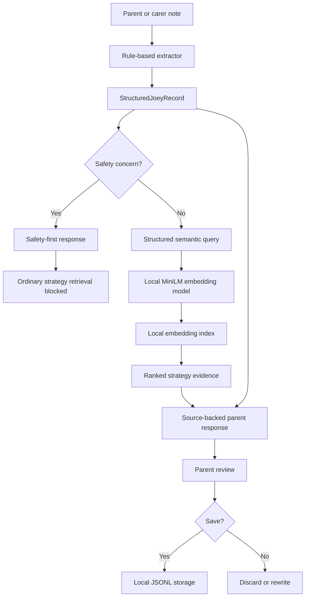

# Hey Joey — Local Conversational Support and Semantic Retrieval System

Hey Joey is a local-first conversational support prototype designed to
help parents and carers record observations about neurodivergent
children.

The system converts natural-language notes into structured records,
checks for safety-sensitive content and retrieves relevant,
source-backed strategies from an approved local Hey Joey document
corpus.

No OpenAI, Claude or other paid language-model API is required.

## Project Motivation

Parents and carers often record meaningful observations in natural
language:

> My child covered their ears and wanted to leave when the classroom
> became noisy.

Important information may be present in that note, including:

- behaviour or signal;
- possible trigger;
- environment;
- mood;
- anxiety;
- support category;
- missing context;
- safety concerns.

Hey Joey turns that free-text observation into a reviewable structured
record and retrieves relevant support passages from the local strategy
library.

## Core Workflow

```text
Parent observation
→ structured extraction
→ safety check
→ local semantic retrieval
→ source-backed response
→ parent confirmation
→ optional local save
```

## Key Features

- Local rule-based structured extraction
- Pydantic-validated Joey records
- Safety and self-injury detection
- Medication-sensitive response rules
- Parent confirmation before saving
- DOCX and TXT strategy-document processing
- Strategy-aware chunking with source provenance
- Local Sentence Transformers embeddings
- Semantic search across real Hey Joey strategy documents
- Source-backed parent responses
- Rule-based retrieval baseline
- Formal functional and retrieval evaluations
- No paid AI API dependency

## System Architecture



Detailed architecture:

`docs/final_system_architecture.md`

## Strategy Corpus

The final local corpus contains:

- 10 approved strategy documents
- 9 DOCX files
- 1 TXT file
- 359 searchable chunks
- 257 strategy chunks
- 102 contextual chunks

The documents cover areas including:

- friendship
- toilet training
- sensory processing
- behavioural and emotional regulation
- crisis management
- hygiene
- sleep and bedtime
- eating and mealtime
- communication
- social anxiety

The proprietary source documents and generated index are not included
in Git.

## Local Embedding Model

The semantic retriever uses:

```text
sentence-transformers/all-MiniLM-L6-v2
```

The model generates 384-dimensional unit-normalised embeddings.

The embedding index is built and searched locally.

## Evaluation Results

### Integrated Functional Evaluation

The final integrated MVP passed:

```text
7/7 predefined synthetic cases
63/63 functional checks
```

The evaluation covered:

- structured record creation;
- confirmation requirements;
- semantic strategy retrieval;
- source provenance;
- response disclaimers;
- safety-sensitive behaviour;
- self-injury handling.

This means the MVP passed its designed functional test suite. It does
not mean the system is universally or clinically 100% accurate.

### Rule-Based versus Semantic Retrieval

| Metric | Rule-based baseline | Semantic retriever |
|---|---:|---:|
| Hit@1 | 3/10 | 8/10 |
| Hit@3 | 5/10 | 9/10 |
| Mean Reciprocal Rank | 0.4000 | 0.8333 |
| Average latency | 0.000493 s | 0.029215 s |

On the ten-query comparison set, semantic retrieval substantially
improved relevant-result ranking and coverage.

The rule-based baseline remained faster, while the semantic retriever
provided stronger retrieval quality with an average post-warm-up search
time of approximately 29 milliseconds.

## Repository Structure

```text
app/
├── extractor.py
├── joey_cli.py
├── response_builder.py
└── schemas.py

data/
├── indexes/                    # Local generated index, ignored by Git
├── local/                      # Confirmed records, ignored by Git
├── processed/                  # Generated text and chunks
└── raw/
    └── strategies/             # Approved source documents, ignored by Git

docs/
├── final_system_architecture.md
├── local_embedding_index.md
├── project_limitations.md
├── semantic_strategy_retrieval.md
└── strategy_document_chunking.md

evaluation/
├── run_semantic_end_to_end_evaluation.py
├── run_retrieval_comparison.py
├── semantic_end_to_end_test_cases.json
└── retrieval_comparison_cases.json

rag/
├── build_embedding_index.py
├── document_loader.py
├── joey_strategy_service.py
├── semantic_retriever.py
├── strategy_chunker.py
└── strategy_retriever.py

safety/
└── safety_guard.py
```

## Installation

Create or activate a Python environment, then run:

```powershell
python -m pip install -r requirements.txt
```

The first semantic-model run downloads the embedding model.

## Build the Local Strategy Pipeline

Place approved source documents in:

```text
data/raw/strategies/
```

Process the documents:

```powershell
python -m rag.document_loader
```

Create strategy chunks:

```powershell
python -m rag.strategy_chunker
```

Build the local semantic index:

```powershell
python -m rag.build_embedding_index
```

## Run Joey

```powershell
python -m app.joey_cli
```

Joey will:

1. ask for a parent or carer observation;
2. generate a structured record;
3. check for safety-sensitive content;
4. retrieve local strategy evidence where appropriate;
5. produce a cautious parent-facing response;
6. ask for confirmation before saving.

## Run the Evaluations

Integrated evaluation:

```powershell
python -m evaluation.run_semantic_end_to_end_evaluation
```

Retrieval comparison:

```powershell
python -m evaluation.run_retrieval_comparison
```

## Safety Principles

Hey Joey:

- does not diagnose;
- does not provide medical treatment;
- does not recommend medication changes;
- does not treat similarity scores as clinical confidence;
- prioritises safety signposting for risk-sensitive entries;
- blocks ordinary strategy retrieval for recognised safety concerns;
- requires parent or carer confirmation before saving.

## Privacy

The following remain local and are excluded from Git:

```text
data/raw/strategies/
data/processed/strategies_text/
data/processed/strategy_chunks/
data/indexes/
data/local/
```

This prevents proprietary strategy content, embeddings and confirmed
parent observations from being uploaded to the repository.

## Limitations

The current system is a local research prototype.

It has not been clinically validated, deployed into production or tested
at scale with real families.

Further limitations are documented in:

`docs/project_limitations.md`

## Future Work

Potential future extensions include:

- multi-turn follow-up answers that update individual fields;
- Bubble or web-application integration;
- hybrid keyword and semantic retrieval;
- expert-labelled retrieval evaluation;
- longitudinal weekly insight generation;
- encrypted production storage;
- authentication and access controls;
- audit logging and monitoring;
- Docker and FastAPI deployment;
- user testing with appropriate consent and governance.

## Final Project Status

The completed project is:

> A local-first, safety-aware conversational data-input and semantic
> retrieval prototype that transforms parent observations into
> structured records and retrieves source-backed support strategies
> from an approved local document corpus.

The core MVP is complete.