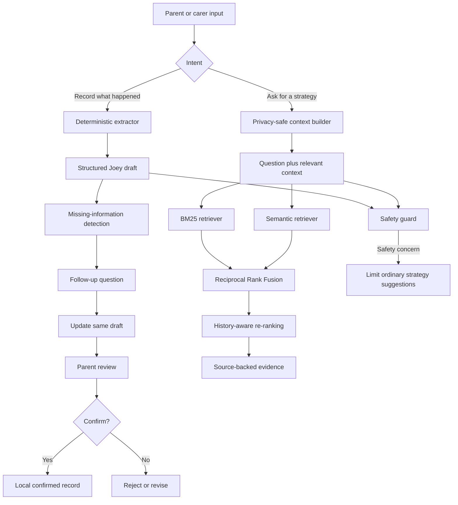

# Hey Joey: Context-Aware Hybrid RAG Assistant

A local-first, safety-aware conversational support system designed for future integration with the Hey Joey application.

The prototype helps parents and carers:

1. turn natural-language observations into structured journal data;
2. answer follow-up questions when important information is missing;
3. review and confirm records before saving;
4. retrieve relevant, source-backed strategies from an approved local strategy corpus;
5. demonstrate privacy-safe personalisation using synthetic profile, journal and strategy-history data.

The project was developed as an MSc artificial intelligence project. It does not require paid OpenAI, Anthropic or other commercial AI APIs.

---

## Project purpose

Hey Joey already includes structured areas such as Journal Entries, Weekly Insights, Quick Track, Active Strategies, Strategy Feedback, Medicine, Notes and supported-person profiles.

The central problem is that parents and carers may find it time-consuming to enter the same information manually across several screens. This project introduces Joey as an intelligent layer that supports two connected workflows.

### 1. Conversational data input

A parent describes what happened in their own words:

```text
Parent observation
    ↓
Deterministic structured extraction
    ↓
Missing-information detection
    ↓
Follow-up question
    ↓
Same draft record updated
    ↓
Parent review and confirmation
```

Example:

> The classroom was loud and she covered her ears.

Joey can prepare a draft containing anxiety level, mood zone, mood labels, behaviour, activity, environment, possible triggers, relevant support categories, safety flags and missing information.

Joey can then ask a focused follow-up question, such as:

> Was the sound too loud, unexpected, or difficult to escape from?

The answer updates the same draft rather than creating a new entry.

### 2. Context-aware strategy support

A parent can ask:

> What could help my child cope with loud classroom noise?

The system then performs:

```text
Current question
    +
Relevant confirmed context
    ↓
Privacy filtering
    ↓
BM25 lexical retrieval
    +
Semantic retrieval
    ↓
Reciprocal Rank Fusion
    ↓
History-aware re-ranking
    ↓
Source-backed strategy evidence
```

The result includes the strategy code, title, collection, source file, evidence passage and cautious history wording such as:

- already active;
- helped somewhat;
- previously reported as unsuccessful;
- appears to be a new option.

---

## Key features

### Structured journal extraction

The local extractor produces a `StructuredJoeyRecord` with:

- entry type;
- summary;
- date;
- time of day;
- anxiety level;
- mood zone;
- mood labels;
- behaviours;
- activity;
- environment;
- possible triggers;
- Quick Track suggestions;
- strategy categories;
- risk flags;
- missing information;
- follow-up question;
- confidence;
- parent-confirmation requirement.

### Multi-turn follow-up workflow

The conversation manager keeps one draft throughout the interaction.

Supported states:

```text
collecting_information
ready_for_review
confirmed
rejected
```

Nothing is saved automatically.

### Genuine Hybrid RAG

The final retrieval pipeline combines:

- local BM25 lexical retrieval;
- local semantic retrieval using `sentence-transformers/all-MiniLM-L6-v2`;
- Reciprocal Rank Fusion;
- strategy-level deduplication;
- metadata and source preservation.

The original rule-based retriever remains in the repository as a baseline.

### Privacy-safe context selection

Synthetic context records demonstrate how future application data could be selected without exposing unnecessary personal information.

The retrieval context deliberately excludes fields such as:

- names;
- email addresses;
- dates of birth;
- addresses;
- medication names;
- dosage details.

Only relevant confirmed context is selected.

### History-aware personalisation

Synthetic active-strategy and feedback records demonstrate how Joey could distinguish between:

- an active strategy;
- a previously helpful strategy;
- a previously unsuccessful strategy;
- an unseen strategy.

History applies only a small, transparent score adjustment. Retrieval relevance remains the main ranking signal.

### Safety-aware handling

The system is designed to avoid:

- diagnosis;
- treatment claims;
- medication recommendations;
- dosage advice;
- unsupported causal conclusions;
- automatic saving;
- ordinary strategy suggestions during urgent safety situations.

---

## System architecture



---

## Strategy corpus

The current local corpus contains:

- 10 approved strategy documents;
- 359 searchable chunks;
- 257 strategy chunks;
- 102 context chunks;
- 384-dimensional local embeddings;
- source, collection, theme and strategy metadata.

The corpus covers areas including sensory processing, behavioural challenges, emotional regulation, communication, social anxiety, sleep, eating and mealtimes, hygiene, toilet training, crisis management and friendship support.

The private strategy documents, extracted text, chunks and indexes are excluded from Git.

---

## Evaluation

### Retrieval comparison

The original rule-based baseline and semantic retriever were evaluated on the same 10 synthetic strategy queries.

| Retriever | Hit@1 | Hit@3 | MRR | Average latency |
|---|---:|---:|---:|---:|
| Rule-based baseline | 3/10 | 5/10 | 0.4000 | 0.000493 s |
| Semantic retrieval | 8/10 | 9/10 | 0.8333 | 0.029215 s |

These results apply only to the designed synthetic evaluation set. They do not represent universal, clinical or production performance.

### Integrated workflow

The integrated Joey MVP passed:

- 7/7 predefined synthetic end-to-end cases;
- 63/63 functional checks.

Additional component tests pass:

- 3/3 multi-turn conversation tests;
- 4/4 synthetic context-builder tests;
- 4/4 history-aware personalisation tests.

### Hybrid evaluation status

The BM25 plus semantic hybrid pipeline is implemented and functioning.

A final three-way comparison still needs to be completed using the same evaluation set:

```text
Rule-based baseline
vs
Semantic-only retrieval
vs
Hybrid retrieval
```

The final comparison should report Hit@1, Hit@3, Mean Reciprocal Rank and average latency.

---

## Project structure

```text
Chatbot_Joey/
├── app/
│   ├── schemas.py
│   ├── extractor.py
│   ├── conversation_manager.py
│   ├── joey_cli.py
│   ├── joey_conversation_demo.py
│   ├── context_builder.py
│   ├── context_builder_demo.py
│   ├── history_aware_strategy_demo.py
│   ├── response_builder.py
│   └── streamlit_app.py
│
├── rag/
│   ├── document_loader.py
│   ├── strategy_chunker.py
│   ├── build_embedding_index.py
│   ├── strategy_retriever.py
│   ├── semantic_retriever.py
│   ├── bm25_retriever.py
│   ├── hybrid_retriever.py
│   ├── joey_strategy_service.py
│   ├── context_aware_strategy_service.py
│   ├── strategy_history_ranker.py
│   └── history_aware_strategy_service.py
│
├── safety/
│   └── safety_guard.py
│
├── evaluation/
│   ├── run_end_to_end_evaluation.py
│   ├── run_retrieval_comparison.py
│   ├── run_semantic_end_to_end_evaluation.py
│   ├── test_multi_turn_conversation.py
│   ├── test_context_builder.py
│   └── test_history_aware_strategy.py
│
├── data/
│   ├── synthetic/
│   ├── raw/
│   ├── processed/
│   ├── indexes/
│   └── local/
│
├── docs/
├── requirements.txt
└── README.md
```

---

## Installation

### 1. Clone the repository

```powershell
git clone <repository-url>
cd Chatbot_Joey
```

### 2. Create and activate a virtual environment

```powershell
python -m venv .venv
.venv\Scripts\Activate.ps1
```

### 3. Install dependencies

```powershell
pip install -r requirements.txt
```

Main dependencies include Pydantic, pandas, openpyxl, python-docx, pypdf, sentence-transformers, NumPy and Streamlit.

---

## Preparing the local strategy index

Place the approved private strategy documents in the ignored local strategy folder, then run:

```powershell
python -m rag.document_loader
python -m rag.strategy_chunker
python -m rag.build_embedding_index
```

The generated index should not be committed.

---

## Running the system

### Joey command-line workflow

```powershell
python -m app.joey_cli
```

### Multi-turn data-input demonstration

```powershell
python -m app.joey_conversation_demo
```

Suggested input:

```text
The classroom was loud and she covered her ears.
```

### BM25 retrieval demonstration

```powershell
python -m rag.bm25_retriever
```

### Hybrid retrieval demonstration

```powershell
python -m rag.hybrid_retriever
```

### Context-aware retrieval demonstration

```powershell
python -m app.context_builder_demo
```

### History-aware strategy demonstration

```powershell
python -m app.history_aware_strategy_demo
```

Suggested question:

```text
What could help my child cope with loud classroom noise?
```

### Streamlit prototype

```powershell
streamlit run app/streamlit_app.py
```

The Streamlit interface is currently a technical prototype rather than a recreation of the full production Hey Joey application.

---

## Running tests

```powershell
python -m evaluation.test_multi_turn_conversation
python -m evaluation.test_context_builder
python -m evaluation.test_history_aware_strategy
python -m evaluation.run_semantic_end_to_end_evaluation
python -m evaluation.run_retrieval_comparison
```

---

## Data and privacy

Ignored private folders include:

```text
data/local/
data/raw/strategies/
data/processed/strategies_text/
data/processed/strategy_chunks/
data/indexes/
```

Files under `data/synthetic/` contain invented demonstration data only.

Real parent, child or carer data must not be committed.

---

## Important limitations

- The prototype is not connected to the live Hey Joey Bubble application or production database.
- Live profiles, Journal Entries, Quick Track records and strategy feedback are not accessed.
- Synthetic records demonstrate the proposed integration contract.
- The system does not provide clinical advice, diagnosis or medication guidance.
- The current response layer is mainly deterministic and retrieval-based rather than a free-form generative LLM.
- The full dashboard, onboarding, Notes, Medicine, Quick Track and Insights interfaces have not been recreated.
- Retrieval evaluation uses a small synthetic test set.
- History-aware adjustments are prototype rules and require stakeholder validation.
- Context selection currently relies on rule-based topic matching.
- The system has not been evaluated with real families or deployed in production.

---

## Future integration

A future production integration could replace the synthetic adapters with secure application services:

```text
Bubble or application database
    ↓
Profile adapter
Journal adapter
Quick Track adapter
Active Strategy adapter
Strategy Feedback adapter
    ↓
Privacy-safe context builder
    ↓
Hybrid and history-aware retrieval
```

Possible future work includes:

- final hybrid comparative evaluation;
- one unified Streamlit demonstration;
- SQLite persistence;
- FastAPI service layer;
- Docker packaging;
- deployment;
- stakeholder usability testing;
- retrieval threshold calibration;
- audit logging;
- role-based access control.

---

## Responsible-use statement

Hey Joey is a decision-support and information-retrieval prototype.

It is not intended to:

- diagnose a condition;
- replace professional support;
- recommend medication;
- change a dosage;
- determine the cause of a behaviour;
- provide emergency or crisis care.

Parents and carers remain in control of all records and decisions. Joey-generated structures and retrieved strategies must be reviewed before use.

---

## Current project status

| Area | Status |
|---|---|
| Deterministic structured extraction | Complete |
| Safety and confirmation layer | Complete |
| Local semantic retrieval | Complete |
| BM25 lexical retrieval | Complete |
| Reciprocal Rank Fusion | Complete |
| Multi-turn follow-up updating | Complete |
| Synthetic privacy-safe context builder | Complete |
| Synthetic history-aware personalisation | Complete |
| Component testing | Complete |
| Final hybrid comparative evaluation | Pending |
| Unified polished demonstration | Pending |
| Live Hey Joey integration | Not available |
| Production deployment | Future work |

---

## Summary

The project demonstrates a complete local AI subsystem for Hey Joey:

```text
Conversational structured-data input
+
Safety and parent confirmation
+
Privacy-safe context selection
+
BM25 and semantic retrieval
+
Reciprocal Rank Fusion
+
History-aware personalisation
+
Source-backed strategy evidence
```

The core AI and retrieval objectives are implemented. The remaining work focuses on final evaluation, documentation and presentation rather than another major AI feature.
