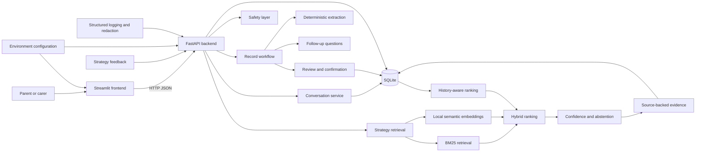
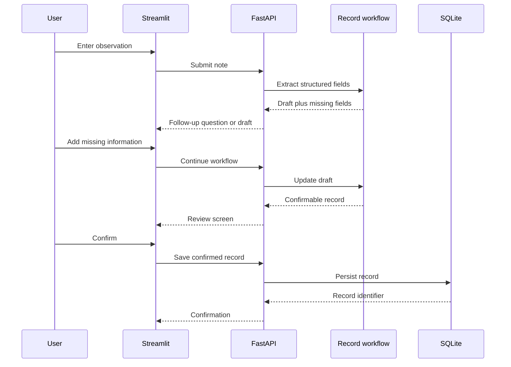
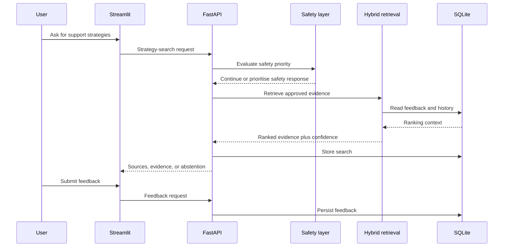
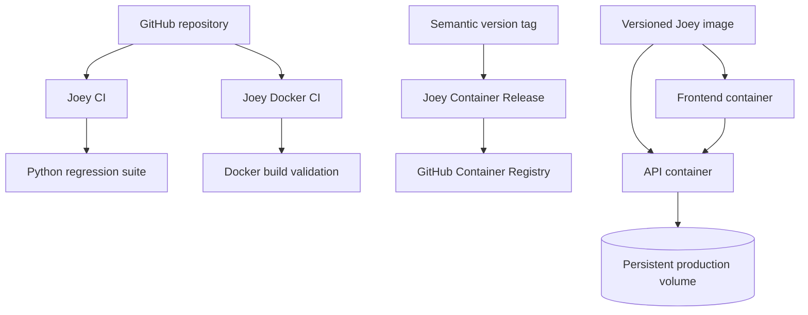

# Hey Joey System Architecture

## 1. Architecture goal

Hey Joey is designed as a local-first, privacy-aware support system rather than
a generic chatbot.

The system must continue to provide useful, testable behaviour even without a
paid model API. Deterministic workflow logic, safety handling, persistence,
retrieval, configuration, and operational controls therefore remain separate
from the semantic model component.

## 2. High-level architecture

## 3. Main runtime components

### Streamlit frontend

The Streamlit application provides the user-facing workflow. It collects
observations, displays follow-up questions, presents structured drafts,
supports review and confirmation, shows strategy results and evidence, and
maintains conversation state through the API.

The frontend does not access SQLite directly. It communicates with the backend
over HTTP.

### FastAPI backend

FastAPI is the system boundary for application operations. It exposes health,
readiness, version, record, strategy-search, feedback, and conversation
endpoints.

The backend coordinates workflow logic, retrieval, safety decisions,
persistence, configuration, and error handling.

### Record workflow

The record workflow turns natural-language parent or carer observations into a
structured draft.

The workflow is intentionally explicit:

1. receive an observation;
2. extract known fields;
3. identify missing information;
4. ask deterministic follow-up questions;
5. present a structured draft;
6. require review and confirmation;
7. save the confirmed record.

This keeps important data-entry decisions visible and testable.

### Safety layer

Safety handling is evaluated before ordinary assistance. The layer can
prioritise urgent or safeguarding-oriented responses and prevents strategy
retrieval from overriding higher-priority safety behaviour.

The prototype is not an emergency, clinical, or safeguarding service.

### Hybrid strategy retrieval

The retrieval subsystem searches an approved local strategy-document library.

It combines:

- BM25 lexical retrieval;
- local semantic embeddings;
- hybrid score aggregation;
- confidence checks;
- abstention when evidence is weak;
- source-backed evidence display;
- stored feedback and history-aware ranking.

Semantic retrieval is a component of the system, not the only source of
decision-making.

### SQLite persistence

SQLite stores confirmed records and runtime history, including conversations,
strategy searches, and feedback.

Runtime databases are private operational files. They are excluded from
version control and public Docker build contexts.

## 4. Request flows

### Parent-note capture

### Strategy retrieval

## 5. Operational architecture

The Docker Compose configuration runs separate API and frontend services. The
frontend waits for a healthy API and communicates with it using the internal
Compose service name.

Production configuration adds resource limits, health checks, log rotation,
reduced privileges, structured logging, and a persistent named volume.

## 6. Configuration model

Runtime behaviour is controlled through central environment-based settings.

The system separates:

- local development defaults;
- production-style defaults;
- safe synthetic-only public demonstration behaviour;
- explicit decisions required before private-data operation.

Real `.env` files are not committed. Safe example templates document the
expected settings.

## 7. Testing and release controls

The repository contains automated tests for application behaviour,
configuration, repository safety, API integration, persistence, retrieval,
Docker configuration, and release workflows.

At release `v0.1.0`, the local regression runner reports 21 passing test
modules.

GitHub Actions provides:

- Python compilation and regression validation;
- Docker Compose and image-build validation;
- version-tagged GHCR container publishing.

External actions are pinned to immutable commit SHAs and workflows use scoped
permissions.

## 8. Privacy and trust boundaries

The public repository and public container release must contain synthetic
demonstration material only.

The following remain outside the trusted public boundary:

- identifiable parent, carer, child, or family information;
- private runtime databases;
- real environment files and credentials;
- confidential documents not approved for publication.

Repository checks reduce accidental exposure but do not replace manual review,
formal security testing, privacy governance, or safeguarding approval.

## 9. Current limitations

The current architecture does not yet provide:

- user authentication or role-based access control;
- multi-user or multi-tenant isolation;
- encryption and managed secret storage;
- production backup and recovery;
- monitoring, alerting, and incident response;
- formal data-retention and deletion workflows;
- clinical validation or safeguarding approval;
- public production deployment with real family data.

These are deliberate boundaries for the `v0.1.0` MSc/portfolio prototype.

## 10. Related documentation

- `docs/data_input_schema.md`
- `docs/safety_response_layer.md`
- `docs/strategy_retrieval_layer.md`
- `docs/strategy_document_chunking.md`
- `docs/semantic_strategy_retrieval.md`
- `docs/local_embedding_index.md`
- `docs/project_limitations.md`
- `docs/production_configuration.md`
- `docs/container_release.md`
